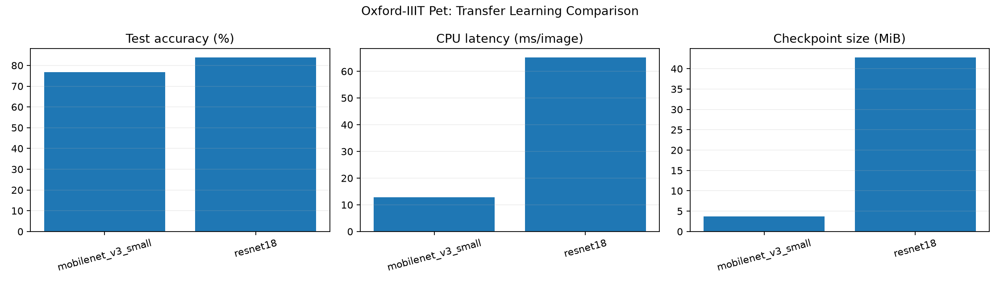
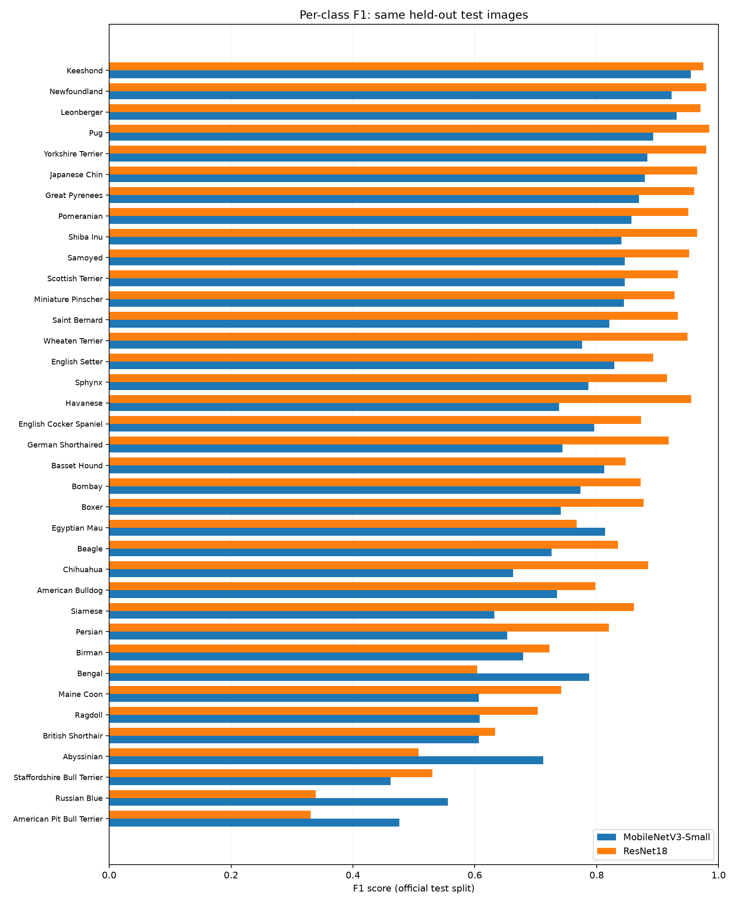

# Efficient Image Classification: Accuracy vs. Inference Speed

A reproducible, CPU-based **transfer learning benchmark** comparing MobileNetV3-Small and ResNet18 on the **Oxford-IIIT Pet** image classification dataset. The project examines the trade-off between predictive accuracy, inference latency, and model storage size.

> **Study scope:** This is an **initial, single-epoch experiment**, not a comprehensive model ranking. The reported measurements are specific to the experimental setup and CPU used.

## Research question

How does a lightweight convolutional neural network compare with a larger architecture in terms of classification accuracy, CPU inference time, and model size when both use frozen ImageNet-pretrained feature extractors?

## Results

Both models were trained for **1 epoch**, using the same 2,944-image training split and 736-image validation split, and evaluated on the separate official **3,669-image test set**.

| Metric | MobileNetV3-Small | ResNet18 |
| :--- | ---: | ---: |
| Best validation accuracy | 79.35% | 85.60% |
| **Test accuracy** | **76.75%** | **83.86%** |
| **CPU inference latency** (ms/image) | **12.81** | **65.21** |
| **Checkpoint size** (MiB) | **3.75** | **42.78** |
| Training epochs | 1 | 1 |



**Initial observation:** In this run, MobileNetV3-Small had approximately **5.1x lower CPU inference latency** and a much smaller checkpoint, while ResNet18 achieved **7.11 percentage points higher test accuracy**. This illustrates an accuracy-efficiency trade-off *for this specific setup*; it does not establish a general ranking of the architectures.

Detailed output: [experimental report](results/summary.md) · [CSV results](results/comparison.csv).

<!-- classwise-analysis:start -->
## Class-wise error analysis

The saved **single-epoch** checkpoints were evaluated again on the **same official test split** to examine class-level errors. This is descriptive analysis, **not an independent experiment or additional training**.

| Model | Test accuracy | Macro F1 | Weighted F1 |
| :--- | ---: | ---: | ---: |
| MobileNetV3-Small | 76.75% | 75.94% | 76.02% |
| ResNet18 | 83.86% | 82.84% | 82.93% |



[Detailed analysis](results/class_analysis.md) · [Per-class metrics CSV](results/per_class_metrics.csv) · [Confusion matrices](results/confusion_matrices.png)

To reproduce the analysis after training, run `.\.venv\Scripts\python.exe src\analyze_results.py` from the repository root. It does not retrain the models.

**Interpretation:** Macro F1 gives equal weight to every breed; weighted F1 accounts for class support. These test-set observations must not be used to choose new hyperparameters or model variants.
<!-- classwise-analysis:end -->

## Dataset and evaluation protocol

- **Dataset:** [Oxford-IIIT Pet](https://www.robots.ox.ac.uk/~vgg/data/pets/), with 37 cat and dog breed categories.
- **Train/validation:** 3,680 images from the official `trainval` partition, split into 2,944 training and 736 validation images using stratified sampling (`random_state=42`). The split indices are saved in `splits/`.
- **Test:** The separate official partition of 3,669 images. It is not used for training or choosing the best checkpoint.
- **Training transforms:** Random resized crop to 224 × 224, random horizontal flip, tensor conversion, and ImageNet normalization.
- **Validation/test transforms:** Resize to 256, center crop to 224 × 224, tensor conversion, and ImageNet normalization.
- **Transfer learning:** Initialize both networks using ImageNet-pretrained weights, freeze their existing feature extractors, and train a newly initialized 37-class linear classifier.
- **Optimization:** Adam (`lr=0.001`), cross-entropy loss, batch size 16, one epoch. Checkpoints are selected by validation accuracy.
- **Latency:** Median of 30 single-image forward passes on CPU, following 5 warm-up passes. Input preprocessing and disk I/O are excluded. Measurements are hardware-dependent.
- **Model size:** On-disk size of each saved PyTorch `state_dict` checkpoint (MiB), rather than the size of the original pretrained download.

## Run the project

The following commands are for **Windows PowerShell**, executed from the repository root. Python 3.13 (64-bit) was used for the recorded experiment.

```powershell
# Create a local virtual environment
python -m venv .venv

# Install dependencies
.\.venv\Scripts\python.exe -m pip install -r requirements.txt

# Download and check the dataset (first run only)
.\.venv\Scripts\python.exe src\data.py

# Optional: regenerate the saved, reproducible train/validation split
.\.venv\Scripts\python.exe src\split_data.py

# Check the training/validation loaders
.\.venv\Scripts\python.exe src\dataloaders.py

# Run the experiment on CPU (both models)
.\.venv\Scripts\python.exe src\train.py --epochs 1
```

The training command writes `results/comparison.csv`, `results/model_comparison.png`, and `results/summary.md`. It also saves model checkpoints locally under `checkpoints/`. The pretrained model weights and dataset may be downloaded automatically on first use.

**Note:** The benchmark re-runs training and overwrites the generated result files. CPU latency values may differ on another machine or between runs.

## Repository structure

```text
.
├── src/
│   ├── data.py             # Dataset download and initial inspection
│   ├── split_data.py       # Reproducible, stratified split
│   ├── dataloaders.py      # Training/validation transforms and loaders
│   ├── models.py           # MobileNetV3-Small transfer learning model
│   ├── train.py            # Training, test evaluation, CPU benchmark, reporting
│   └── analyze_results.py # Class-level evaluation of saved checkpoints
├── splits/
│   ├── train_indices.json
│   └── val_indices.json
├── results/
│   ├── comparison.csv
│   ├── model_comparison.png
│   ├── summary.md
│   ├── class_analysis.md
│   ├── classification_metrics.csv
│   ├── per_class_metrics.csv
│   ├── classwise_f1.png
│   └── confusion_matrices.png
├── requirements.txt
├── .gitignore
├── LICENSE
└── README.md
```

The downloaded `data/`, local `.venv/`, and saved `checkpoints/` directories are excluded from version control.

## Limitations and next steps

- **One epoch and one fixed random seed:** More epochs and repeated runs are needed for stronger, more stable conclusions.
- **Frozen backbones:** This benchmark tests linear-head transfer learning, not full fine-tuning or training from scratch.
- **CPU-only latency:** The measurements do not establish performance on mobile phones or other edge devices.
- **Limited timing protocol:** The reported latency excludes preprocessing and uses one example image. An extended benchmark should test more images, repeated sessions, and multiple devices.
- **Test-set discipline:** Any future experiment variants should be chosen using validation data, rather than repeatedly optimizing choices on the reported test set.

Potential extensions include repeated-seed experiments, longer training budgets, and evaluations on actual resource-constrained devices.

## License and acknowledgments

Project source code is released under the [MIT License](LICENSE). The Oxford-IIIT Pet dataset and pretrained model weights are third-party resources governed by their own terms and licenses. Their inclusion in the workflow does not place them under this repository's MIT License.

## Testing and Reproducibility

The repository includes five automated tests covering dataset split integrity, DataLoader functionality, and benchmark result consistency.

To run the tests:

python -m unittest discover -s tests -v

For further details on the experimental setup, see the [Experiment Protocol](docs/experiment_protocol.md).

## Additional Documentation

- [Benchmark interpretation](docs/benchmark_interpretation.md)
- [Reproducibility checklist](docs/reproducibility_checklist.md)
- [Quick results summary](docs/results_summary_guide.md)
