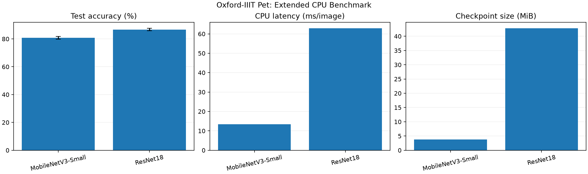
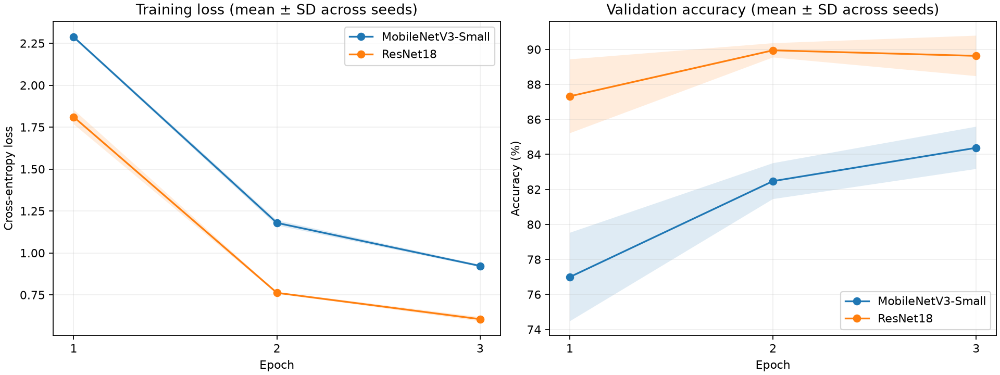

# Efficient Image Classification: Accuracy vs. Inference Speed

A reproducible, CPU-based **transfer learning benchmark** comparing MobileNetV3-Small and ResNet18 on the **Oxford-IIIT Pet** image classification dataset. The project examines the trade-off between predictive accuracy, inference latency, and model storage size.

> **Study scope:** This repository contains an original single-epoch pilot and a follow-up multi-seed CPU benchmark. Results are descriptive, hardware-dependent, and not a general architecture ranking.

## Research question
How does a lightweight convolutional neural network compare with a larger architecture in terms of classification accuracy, CPU inference time, and model size when both use frozen ImageNet-pretrained feature extractors?

<!-- extended-benchmark:start -->

## Extended multi-seed benchmark (main follow-up)

Both models were trained for **3 epochs per run** with the same train/validation split and **3 pre-specified random seeds** (`42, 123, 2026`). Checkpoints were selected using validation accuracy only; held-out test metrics were computed afterwards. This follow-up is more informative than the original single-epoch pilot, but remains a small CPU-only benchmark.

| Metric | MobileNetV3-Small | ResNet18 |
|:--|--:|--:|
| Test accuracy, mean ± SD | 80.83 ± 0.99% | 86.72 ± 0.89% |
| Macro F1, mean ± SD | 80.55 ± 1.21% | 86.37 ± 0.94% |
| Validation accuracy, mean ± SD | 84.38 ± 1.21% | 90.26 ± 0.28% |
| CPU latency (median of run medians) | 13.38 ms | 62.86 ms |
| Checkpoint size (mean) | 3.75 MiB | 42.78 MiB |





[Extended analysis](results/extended/report.md) · [Per-run CSV](results/extended/per_run_metrics.csv) · [Per-class F1](results/extended/classwise_f1.png) · [Confusion matrices](results/extended/confusion_matrices.png) · [Detailed protocol](docs/extended_benchmark_protocol.md)

**Interpretation:** Test-set differences describe these runs and this hardware. The original single-epoch experiment remains below for comparison; its class-wise figures refer to the earlier checkpoints, not to the new runs. The official test set was already viewed in that pilot, so it is not a fresh, previously unseen holdout for the project as a whole.
<!-- extended-benchmark:end -->

## Original single-epoch pilot results

Both models were trained for **1 epoch**, using the same 2,944-image training split and 736-image validation split, and evaluated on the separate official **3,669-image test set**.

| Metric | MobileNetV3-Small | ResNet18 |
| :--- | ---: | ---: |
| Best validation accuracy | 79.35% | 85.60% |
| **Test accuracy** | **76.75%** | **83.86%** |
| **CPU inference latency** (ms/image) | **12.81** | **65.21** |
| **Checkpoint size** (MiB) | **3.75** | **42.78** |
| Training epochs | 1 | 1 |


**Initial observation:** In this run, MobileNetV3-Small had approximately **5.1x lower CPU inference latency** and a much smaller checkpoint, while ResNet18 achieved **7.11 percentage points higher test accuracy**. This illustrates an accuracy-efficiency trade-off *for this specific setup*; it does not establish a general ranking of the architectures.

Detailed output: [experimental report](results/summary.md) · [CSV results](results/comparison.csv).

<!-- classwise-analysis:start -->

## Class-wise error analysis

The saved **single-epoch** checkpoints were evaluated again on the **same official test split** to examine class-level errors. This is descriptive analysis, **not an independent experiment or additional training**.

| Model | Test accuracy | Macro F1 | Weighted F1 |
| :--- | ---: | ---: | ---: |
| MobileNetV3-Small | 76.75% | 75.94% | 76.02% |
| ResNet18 | 83.86% | 82.84% | 82.93% |


[Detailed analysis](results/class_analysis.md) · [Per-class metrics CSV](results/per_class_metrics.csv) · [Confusion matrices](results/confusion_matrices.png)

To reproduce the analysis after training, run `.\.venv\Scripts\python.exe src\analyze_results.py` from the repository root. It does not retrain the models.

**Interpretation:** Macro F1 gives equal weight to every breed; weighted F1 accounts for class support. These test-set observations must not be used to choose new hyperparameters or model variants.
<!-- classwise-analysis:end -->

## Dataset and evaluation protocol

- **Dataset:** [Oxford-IIIT Pet](https://www.robots.ox.ac.uk/~vgg/data/pets/), with 37 cat and dog breed categories.
- **Train/validation:** 3,680 images from the official `trainval` partition, split into 2,944 training and 736 validation images using stratified sampling (`random_state=42`). The split indices are saved in `splits/`.
- **Test:** The separate official partition of 3,669 images. It is not used for training or choosing the best checkpoint.
- **Training transforms:** Random resized crop to 224 × 224, random horizontal flip, tensor conversion, and ImageNet normalization.
- **Validation/test transforms:** Resize to 256, center crop to 224 × 224, tensor conversion, and ImageNet normalization.
- **Transfer learning:** Initialize both networks using ImageNet-pretrained weights, freeze their existing feature extractors, and train a newly initialized 37-class linear classifier.
- **Optimization:** Adam (`lr=0.001`), cross-entropy loss, batch size 16, one epoch for the pilot, and three epochs per seed (three seeds) for the extended benchmark. Checkpoints are selected by validation accuracy.
- **Latency (pilot):** Median of 30 single-image forward passes on CPU, following 5 warm-up passes. Input preprocessing and disk I/O are excluded.
- **Latency (extended):** Five fixed, preprocessed test images; five warm-up passes and 20 timed single-image forward passes per image, summarized by medians. Measurements exclude preprocessing and are hardware-dependent.
- **Model size:** On-disk size of each saved PyTorch `state_dict` checkpoint (MiB), rather than the size of the original pretrained download.

## Run the project

The following commands are for **Windows PowerShell**, executed from the repository root. Python 3.13 (64-bit) was used for the recorded experiment.

```powershell

# Create a local virtual environment
python -m venv .venv

# Install dependencies
.\.venv\Scripts\python.exe -m pip install -r requirements.txt

# Download and check the dataset (first run only)
.\.venv\Scripts\python.exe src\data.py

# Optional: regenerate the saved, reproducible train/validation split
.\.venv\Scripts\python.exe src\split_data.py

# Check the training/validation loaders
.\.venv\Scripts\python.exe src\dataloaders.py

# Reproduce the original single-epoch pilot (both models)
.\.venv\Scripts\python.exe src\train.py --epochs 1

# Reproduce the extended benchmark (3 epochs, 3 seeds)
.\.venv\Scripts\python.exe src\final_benchmark.py --epochs 3 --seeds 42 123 2026
```

The **pilot** command writes `results/comparison.csv`, `results/model_comparison.png`, and `results/summary.md`. The **extended** command writes its metrics, plots, and report under `results/extended/` and documents the procedure in `docs/extended_benchmark_protocol.md`. Model checkpoints are saved locally under `checkpoints/` (excluded from Git). Pretrained weights and the dataset may download on first use.

**Note:** The benchmark re-runs training and overwrites the generated result files. CPU latency values may differ on another machine or between runs.

## Repository structure

```text
.
├── src/
│   ├── data.py
│   ├── split_data.py
│   ├── dataloaders.py
│   ├── models.py
│   ├── train.py
│   ├── analyze_results.py
│   ├── results_summary.py
│   └── final_benchmark.py
├── splits/
│   ├── train_indices.json
│   └── val_indices.json
├── results/
│   ├── comparison.csv
│   ├── model_comparison.png
│   ├── summary.md
│   ├── class_analysis.md
│   ├── classification_metrics.csv
│   ├── per_class_metrics.csv
│   ├── classwise_f1.png
│   ├── confusion_matrices.png
│   └── extended/                 # Three-seed results, figures and per-run records
├── tests/
│   ├── test_project.py
│   ├── test_results_summary.py
│   └── test_extended_benchmark.py
├── docs/
│   ├── experiment_protocol.md
│   ├── extended_benchmark_protocol.md
│   ├── benchmark_interpretation.md
│   ├── reproducibility_checklist.md
│   └── results_summary_guide.md
├── finish_project.ps1
├── requirements.txt
├── .gitignore
├── LICENSE
└── README.md
```

The downloaded `data/`, local `.venv/`, and saved `checkpoints/` directories are excluded from version control.

## Limitations and next steps

- **Limited experimental scope:** The pilot uses one epoch and one seed; the extended benchmark uses three epochs and three seeds. More seeds and larger training budgets would provide stronger evidence.
- **Frozen backbones:** This benchmark tests linear-head transfer learning, not full fine-tuning or training from scratch.
- **CPU-only latency:** The measurements do not establish performance on mobile phones or other edge devices.
- **Limited timing protocol:** The pilot measures one example input, whereas the extended benchmark uses five preprocessed test images. Neither measures preprocessing or performance across different devices.
- **Test-set discipline:** Any future experiment variants should be chosen using validation data, rather than repeatedly optimizing choices on the reported test set.

Potential extensions include additional seeds, longer training budgets, and evaluations on actual resource-constrained devices.

## License and acknowledgments

Project source code is released under the [MIT License](LICENSE). The Oxford-IIIT Pet dataset and pretrained model weights are third-party resources governed by their own terms and licenses. Their inclusion in the workflow does not place them under this repository's MIT License.

## Testing and Reproducibility

The repository includes eleven automated tests covering dataset split integrity, DataLoader functionality, and benchmark result consistency.

To run the tests:

python -m unittest discover -s tests -v

For further details on the experimental setup, see the [Experiment Protocol](docs/experiment_protocol.md).

## Additional Documentation

- [Benchmark interpretation](docs/benchmark_interpretation.md)
- [Reproducibility checklist](docs/reproducibility_checklist.md)
- [Quick results summary](docs/results_summary_guide.md)
