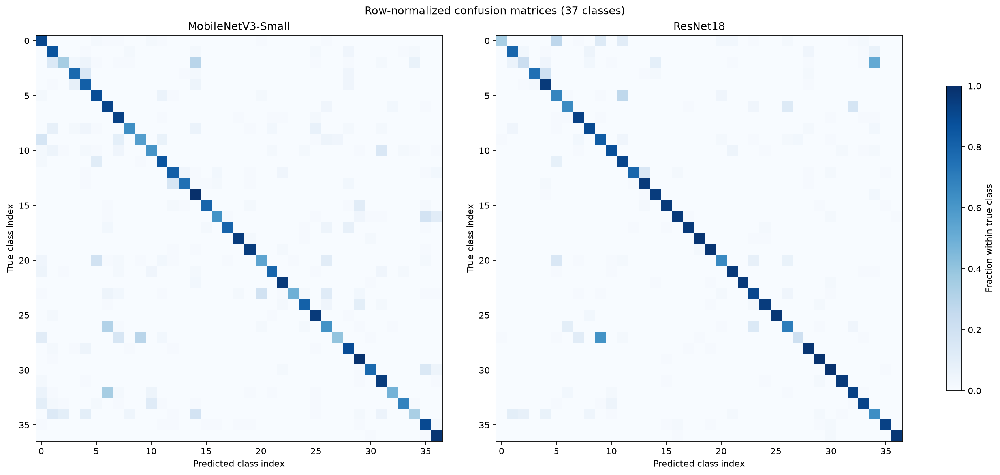

# Class-wise Error Analysis

This analysis uses the existing single-epoch checkpoints and the same official 3,669-image test split. No additional training was performed. This is not an independent replication.

| Model | Test accuracy | Macro F1 | Weighted F1 |
|---|---:|---:|---:|
| MobileNetV3-Small | 76.75% | 75.94% | 76.02% |
| ResNet18 | 83.86% | 82.84% | 82.93% |

## Most frequent class confusions

These are raw misclassification counts, not error rates normalized by class size.

### MobileNetV3-Small

| True breed | Predicted breed | Count |
|---|---|---:|
| Siamese | Birman | 35 |
| Ragdoll | Birman | 31 |
| American Pit Bull Terrier | German Shorthaired | 29 |
| Russian Blue | British Shorthair | 29 |
| Maine Coon | Bengal | 19 |

### ResNet18

| True breed | Predicted breed | Count |
|---|---|---:|
| Russian Blue | British Shorthair | 62 |
| American Pit Bull Terrier | Staffordshire Bull Terrier | 52 |
| Abyssinian | Bengal | 27 |
| Bengal | Egyptian Mau | 27 |
| Basset Hound | Beagle | 20 |

## Interpretation and limitations

- Macro F1 averages class F1 scores equally; weighted F1 weights classes by support.
- A confusion matrix shows which labels the trained models mix up, not why errors occur.
- The test set was already used for the overall accuracy report. Class-wise analysis here is descriptive only.
- Do not tune architectures or hyperparameters against these test-set results.
- Results remain limited to one training epoch, one data split/seed, and CPU evaluation.

Raw numbers are in [classification_metrics.csv](classification_metrics.csv) and [per_class_metrics.csv](per_class_metrics.csv).
