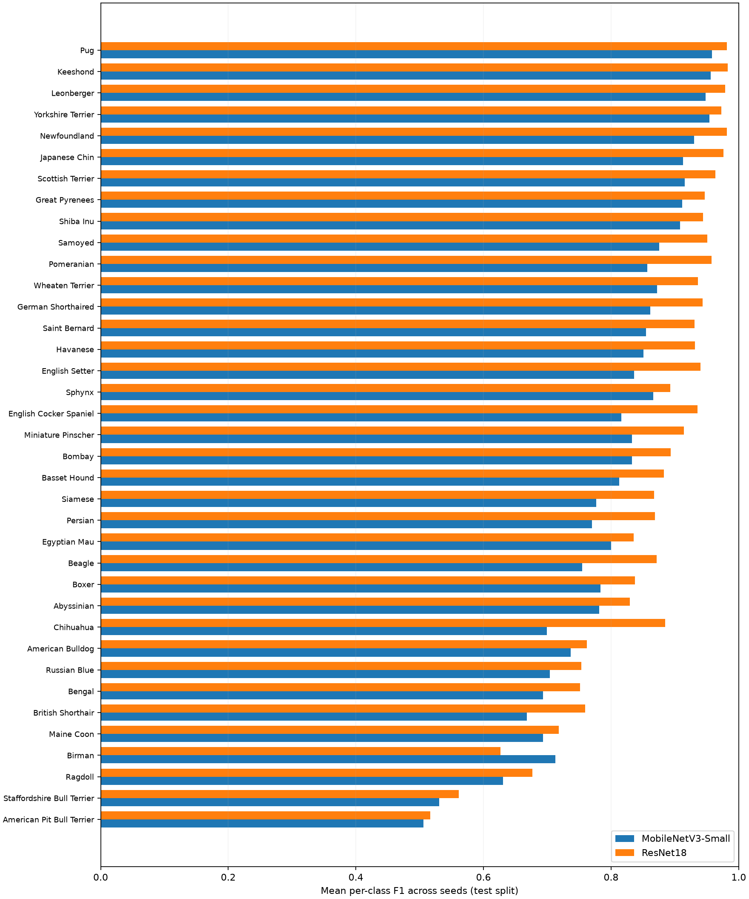
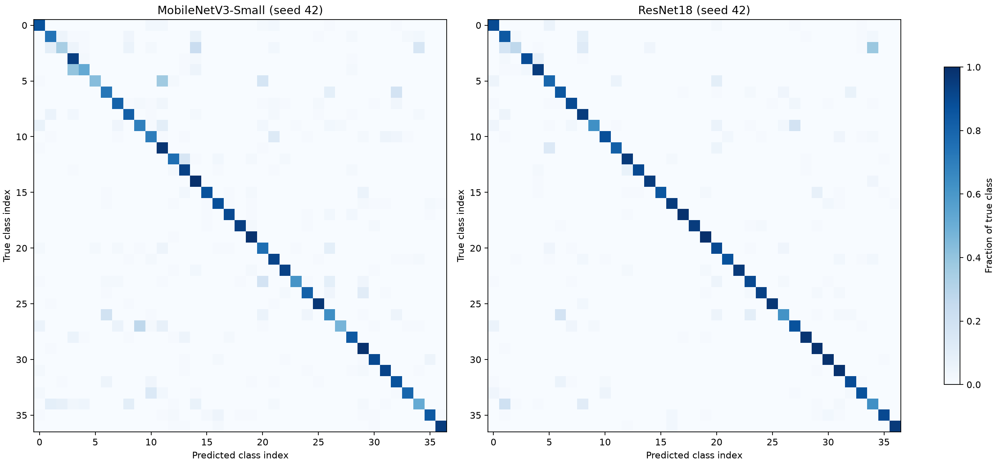

# Extended Multi-Seed CPU Benchmark

**Setup:** 3 pre-specified seeds (42, 123, 2026), 3 epochs per seed and model, batch size 16. The train/validation split is fixed; augmentation and head initialization vary with the seed.

| Metric | MobileNetV3-Small | ResNet18 |
|:--|--:|--:|
| Test accuracy, mean ± SD | 80.83 ± 0.99% | 86.72 ± 0.89% |
| Macro F1, mean ± SD | 80.55 ± 1.21% | 86.37 ± 0.94% |
| Validation accuracy, mean ± SD | 84.38 ± 1.21% | 90.26 ± 0.28% |
| CPU latency (median of run medians) | 13.38 ms | 62.86 ms |
| Checkpoint size (mean) | 3.75 MiB | 42.78 MiB |






## Interpretation and limitations

- Both networks use frozen ImageNet feature extractors; only replacement linear heads are trained.
- Both models use the same class labels, split indices, batch size, optimizer, and epoch budget.
- Checkpoints are selected on validation accuracy. Test scores were recorded after selection and not used to tune hyperparameters.
- The reported mean and sample standard deviation describe only the pre-specified runs, not a confidence interval.
- CPU latency excludes preprocessing and disk I/O. It is hardware- and environment-dependent; results are not mobile-phone benchmarks.
- No paired statistical significance test, fine-tuning study, energy benchmark or cross-hardware replication is claimed.
- Confusion matrices show the FIRST pre-specified seed, not a run chosen using test performance.
- Earlier `results/` figures are for the original one-epoch pilot and are not interchangeable with this follow-up.
- The official test set was also assessed in the earlier pilot; it is therefore not a fresh, previously unseen holdout across the entire project.

## Reproduce

From the repository root on Windows PowerShell:

```powershell
.\.venv\Scripts\python.exe src\final_benchmark.py --epochs 3 --seeds 42 123 2026
```

The script can resume already completed model/seed runs (provided the saved record and local checkpoint still exist). See the [protocol](../../docs/extended_benchmark_protocol.md).
